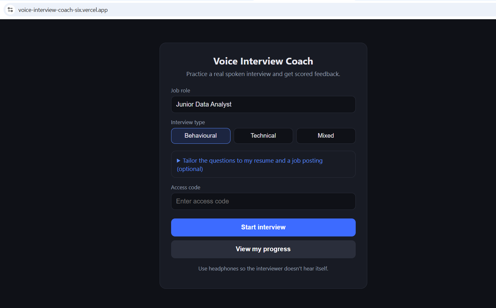
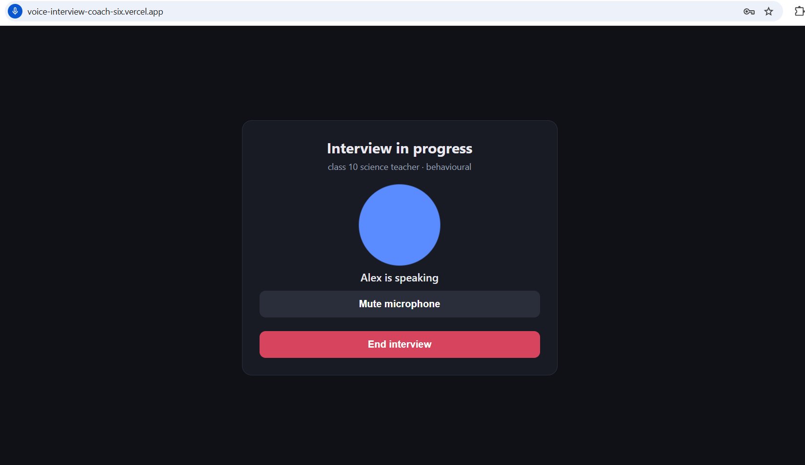
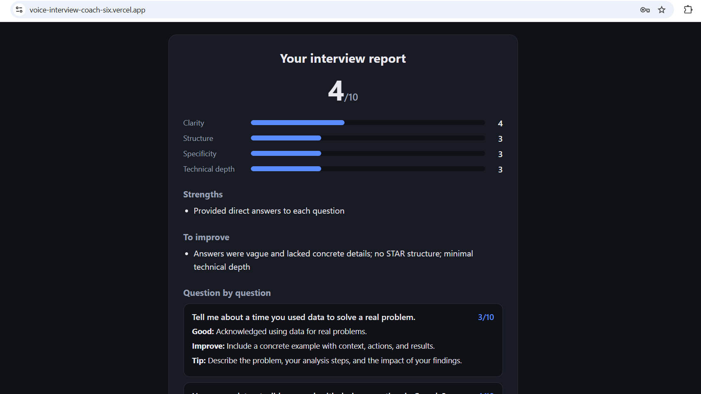
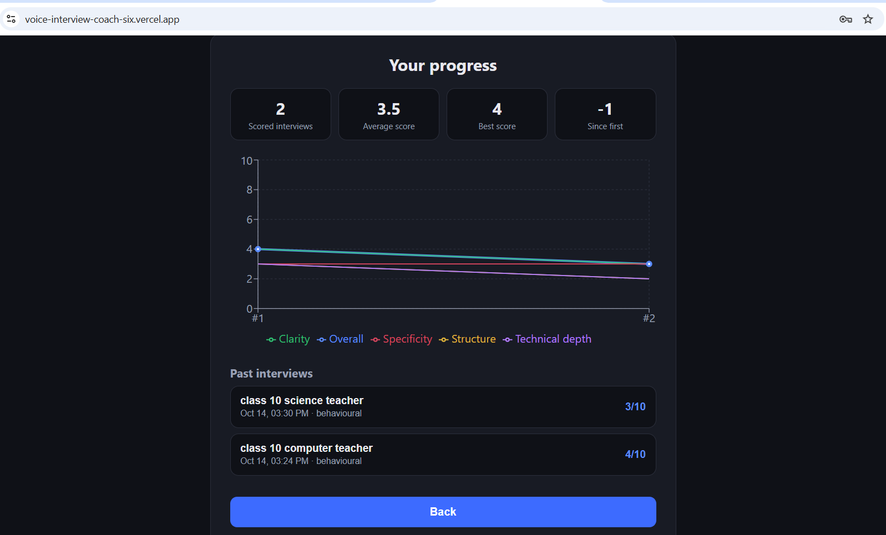
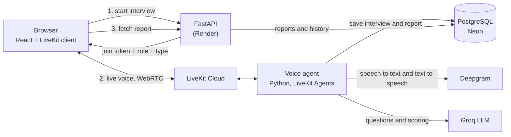

# Voice Interview Coach

Practice a real **spoken** job interview with an AI interviewer, then get a scored report and track your progress over time.

**Live demo:** https://voice-interview-coach-six.vercel.app (access code available on request)

> The demo runs on free hosting, so the first request after a quiet period can take up to a minute while the server wakes up.



## What it does

- **Talk, don't type.** A voice interviewer (Alex) asks questions out loud, listens to your answers, and asks follow-ups. You can interrupt like in a real conversation.
- **Tailored questions.** Upload a resume (PDF or text) and paste a job posting. The AI writes questions about *your* projects and *that* role. Your resume text is deleted from the database as soon as the interview starts.
- **Three interview types:** behavioural, technical, or mixed.
- **Scored report.** After the interview you get scores for clarity, structure (situation, action, result), specificity and technical depth, plus strengths, weaknesses and a tip for every answer.
- **Progress tracking.** Every interview is saved, and a chart shows how your scores change over time.

| Interview | Report | Progress |
|---|---|---|
|  |  |  |

## Architecture



**How an interview flows**

1. The browser asks the API for a join token. The token carries the chosen role, interview type and an anonymous browser ID.
2. The browser joins a LiveKit room. LiveKit starts the voice agent in that room.
3. The agent reads the notes in the token. If a resume or job posting was provided, it generates tailored questions.
4. Speech is turned into text (Deepgram), a language model decides what to say next (Groq), and the reply is spoken back (Deepgram), all streamed so responses start in about a second.
5. When the interview ends, the agent scores the transcript with a second LLM call. The result is validated with Pydantic and saved to PostgreSQL.
6. The browser polls the API until the report is ready, then displays it.

## Tech stack

| Area | Tools |
|---|---|
| Real-time voice | LiveKit Agents (Python), WebRTC |
| Speech | Deepgram (speech-to-text and text-to-speech) |
| LLM | Groq (gpt-oss-20b) |
| Backend | FastAPI, SQLAlchemy, Pydantic |
| Database | PostgreSQL on Neon |
| Frontend | React (Vite), LiveKit React components, Recharts |
| Deployment | LiveKit Cloud (agent), Render (API), Vercel (website), Docker |

## Engineering notes

- **Code-controlled interview flow.** An early version let the LLM count questions itself and it rambled and invented the rest of the interview. Now Python holds the question counter and gives the model one instruction per turn, so every interview has exactly the planned questions.
- **Validated AI output.** Scoring and question generation return JSON that is checked with Pydantic, with a retry on invalid output.
- **Prompt-injection protection.** Resume and job posting text is fenced as data and the model is told never to follow instructions inside it.
- **Privacy by design.** Resume text is stored only briefly, deleted when the interview starts, and the API runs with only the secrets it needs.
- **Abuse protection.** An access code protects the free-tier quotas, and inputs are length-limited and validated.
- **Anonymous history.** Each browser gets a random ID, so history works without accounts.

## Run it locally

**Requirements:** Python 3.10+, [uv](https://docs.astral.sh/uv/), Node 20+, and free accounts at LiveKit Cloud, Deepgram, Groq and Neon.

```bash
git clone https://github.com/YOUR_USERNAME/voice-interview-coach.git
cd voice-interview-coach
cp .env.example .env        # then fill in your keys
uv sync
uv run db.py                # creates the database tables
```

Run three things in separate terminals:

```bash
uv run agent.py dev                              # voice agent
uv run uvicorn server:app --reload --port 8000   # API
cd frontend && npm install && npm run dev        # website on http://localhost:5173
```

## Deployment

- **Agent:** `lk agent create --secrets-file=.env` (LiveKit Cloud builds the `Dockerfile`).
- **API:** Render web service using `Dockerfile.api`, with `LIVEKIT_*`, `DATABASE_URL`, `ACCESS_CODE` and `ALLOWED_ORIGINS` as environment variables.
- **Website:** Vercel with root directory `frontend` and `VITE_API_URL` pointing to the API.

## Project structure

| File | Purpose |
|---|---|
| `agent.py` | Voice interviewer: question flow, transcript, scoring trigger |
| `questions.py` | Generates tailored questions from a resume and job posting |
| `scorer.py` | Scores a transcript and validates the report |
| `server.py` | FastAPI: join tokens, resume upload, reports, history |
| `db.py` | PostgreSQL models and queries |
| `frontend/` | React app |

## Limitations

- Free hosting: the API sleeps when idle, and the free voice-minute allowance is limited.
- English only.
- Scores come from an LLM reading a speech-to-text transcript, so they are coaching feedback, not an exact measure.
- History is tied to one browser (no accounts yet).

## Ideas for next steps

- User accounts and a shareable report link
- Spoken-delivery feedback (pace, filler words) from the audio itself
- Question banks for more roles